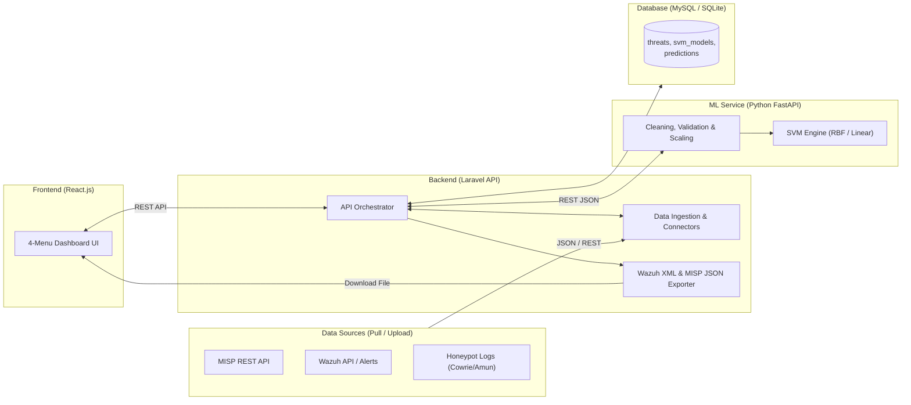

# Rencana Implementasi: Sistem Pertahanan Keamanan Siber Proaktif Berbasis CTI & SVM

Dokumen ini merinci rencana pembangunan kode sistem **Cyber Threat Intelligence (CTI)** menggunakan algoritma **Support Vector Machine (SVM)** berdasarkan Bab 3 dan Bab 4 pada [thesis.pdf](file:///Users/wardix/agy/x/thesis.pdf) serta hasil penyelarasan spesifikasi.

---

## 1. Arsitektur Sistem & Struktur Direktori

Sistem menggunakan arsitektur *three-tier* yang menghubungkan **React.js (Frontend)**, **Laravel PHP (Backend API)**, **Python FastAPI (Machine Learning SVM Service)**, dan **Database (MySQL / SQLite)**.



### Struktur Folder Proyek (`/Users/wardix/agy/x`)
```text
/Users/wardix/agy/x/
├── database/
│   └── schema.sql                 # Skema SQL MySQL sesuai Tabel 4.1 tesis
├── ml-service/                    # Python FastAPI + Scikit-Learn SVM Service (Port 8001)
│   ├── app/
│   │   ├── main.py                # Entrypoint FastAPI & endpoints
│   │   ├── preprocessing.py       # Cleaning, imputasi, validasi, scaling (Bab 4.4 - 4.5)
│   │   ├── feature_selection.py   # Ekstraksi 6 grup fitur & analisis korelasi (Tabel 4.16)
│   │   ├── svm_model.py           # Training, evaluasi (Confusion Matrix, ROC), prediksi SVM
│   │   └── dataset_generator.py   # Generator dataset 12.500 sampel & contoh kasus Tabel 4.2-4.17
│   └── requirements.txt
├── backend/                       # Laravel PHP Backend API (Port 8000)
│   ├── app/
│   │   ├── Http/Controllers/
│   │   │   ├── CtiSourceController.php   # Tarik data MISP, Wazuh, Honeypot & upload log
│   │   │   ├── DatasetController.php     # Manajemen data & trigger pipeline preprocessing
│   │   │   ├── SvmController.php         # Orkestrasi training, evaluasi & prediksi ke Python ML
│   │   │   └── ExportController.php      # Ekspor manual Wazuh XML rules & MISP JSON feed
│   │   └── Services/
│   │       ├── MispConnector.php         # Klien REST API MISP (/api/events/restSearch)
│   │       ├── WazuhConnector.php        # Klien REST API Wazuh & parser alerts.json
│   │       └── HoneypotParser.php        # Parser log JSON Cowrie & Amun (Gambar 1.3)
│   └── database/migrations/              # Migrasi tabel threats, training_runs, predictions
├── frontend/                      # React.js + Vite + Tailwind CSS Dashboard (Port 5173)
│   └── src/
│       ├── pages/
│       │   ├── OverviewPage.jsx          # Menu 1: Ringkasan & Koneksi MISP/Wazuh/Honeypot
│       │   ├── PreprocessingPage.jsx     # Menu 2: Pipeline Cleaning, Validasi & Seleksi Fitur
│       │   ├── SvmTrainingPage.jsx       # Menu 3: Training SVM, Metrik, Confusion Matrix & ROC
│       │   └── PredictionExportPage.jsx  # Menu 4: Prediksi Unseen Data & Ekspor Wazuh/MISP
└── start.sh                       # Skrip untuk menjalankan seluruh service sekaligus
```

---

## 2. Spesifikasi Komponen & Tahapan Implementasi

### Tahap 1: Database & Skema Data (`database/` & `backend/database/`)
1. **Tabel `threats` (Mengacu Tabel 4.1 ditambah fitur terpilih Tabel 4.16):**
   * Kolom utama: `id`, `timestamp`, `source_ip`, `dest_ip`, `src_port`, `port` (destination port), `protocol` (`TCP`, `UDP`, `ICMP`), `payload_size`, `attack_type`, `file_hash`, `ip_reputation_score`, `attack_frequency`, `source_platform` (`MISP`, `Wazuh`, `Honeypot`), `label` (`1` = Threat, `-1` = Benign), `is_cleaned`, `created_at`.
2. **Tabel `svm_training_runs`:**
   * Menyimpan konfigurasi & hasil evaluasi setiap sesi training (`kernel`, `c_param`, `gamma_param`, `train_samples`, `test_samples`, `accuracy`, `precision`, `recall`, `f1_score`, `auc_score`, `confusion_matrix_json`, `roc_curve_json`, `created_at`).
3. **Tabel `honeypot_predictions`:**
   * Menyimpan data baru (*unseen data*) dari Honeypot beserta hasil prediksi SVM (`predicted_label`: `1` atau `-1`, `decision_score`, `exported_to_wazuh`, `exported_to_misp`).
4. **Dukungan Dual-Database:**
   * File `database/schema.sql` disediakan murni untuk MySQL sesuai tesis, sementara konfigurasi `.env` Laravel juga mendukung SQLite lokal secara *out-of-the-box* agar aplikasi bisa langsung dijalankan tanpa terkendala instalasi daemon MySQL.

---

### Tahap 2: Layanan Machine Learning SVM (`ml-service/`)
Mengimplementasikan seluruh formula matematis dan tahapan pemrosesan dari Bab 3 & Bab 4 menggunakan Python (`scikit-learn`, `pandas`, `numpy`):

1. **Data Cleaning (Bab 4.4.3):**
   * **Penghapusan Duplikat:** $D_{\text{clean}} = D - D_{\text{duplicate}}$ berdasarkan kombinasi atribut identik (Tabel 4.2 & 4.3).
   * **Imputasi Missing Values:** *Mean imputation* untuk fitur numerik (`payload_size`) dan *Mode imputation* untuk fitur kategorikal (`protocol`, `attack_type`) (Tabel 4.4 & 4.5).
   * **Filter Atribut Tidak Relevan:** Memisahkan/membuang atribut non-prediktif seperti `event_id` dan teks `description` mentah (Tabel 4.6 & 4.7).
   * **Standardisasi Format:** Konversi `timestamp` ke format ISO (`YYYY-MM-DD HH:MM:SS`), `protocol` ke huruf kapital (`TCP`/`UDP`), pembersihan teks `"bytes"` pada `payload_size`, dan penyeragaman label (Tabel 4.8 & 4.9).
2. **Data Validation (Bab 4.4.4):**
   * **Konsistensi Skema:** Konversi protokol numerik IANA (mis. `6` $\rightarrow$ `TCP`, `17` $\rightarrow$ `UDP`) dan penyeragaman tipe data (Tabel 4.10 & 4.11).
   * **Validasi Rentang Fitur:** Memeriksa `port` dalam rentang `0–65535` (di luar rentang dihapus) dan `payload_size >= 0` (nilai negatif dikoreksi ke `0` atau dihapus) (Tabel 4.12 & 4.13).
   * **Penghapusan Entri Corrupt:** Membuang baris dengan `NULL` timestamp, IP tidak valid (`???`), atau port `NaN` (Tabel 4.14 & 4.15).
3. **Feature Selection & Preprocessing (Bab 4.4.5 & 4.5):**
   * **Fitur Terpilih (Tabel 4.16):** `ip_reputation_score`, `attack_frequency`, `protocol`, `port`, `payload_size`, dan fitur turunan `file_hash_score`, dilengkapi *correlation analysis* dengan *threshold* untuk membuang fitur redundan.
   * **Encoding:** *Label Encoding* untuk `attack_type`, *One-Hot Encoding* untuk `protocol` (`TCP`, `UDP`, `ICMP`), dan konversi label target $Y \in \{1, -1\}$.
   * **Feature Scaling (Z-Score Standardization):**
     $$x' = \frac{x - \mu}{\sigma}$$
4. **Algoritma Support Vector Machine (Bab 4.6 – 4.8 & 4.10):**
   * **Data Splitting:** Pembagian 80% *Training Set* dan 20% *Testing Set* secara *stratified*.
   * **Training Model:** Mendukung kernel **RBF** ($K(x_i, x_j) = \exp(-\gamma \|x_i - x_j\|^2)$) dan **Linear** ($f(x) = w^T x + b$), lengkap dengan parameter $C$ dan $\gamma$.
   * **Evaluasi Model:** Menghitung *Accuracy*, *Precision*, *Recall*, *F1-Score*, *Confusion Matrix* (`TP`, `TN`, `FP`, `FN`), dan kurva *ROC* beserta nilai *AUC*.
   * **Prediksi Unseen Data:** Mengklasifikasikan data baru dari Honeypot menjadi `1` (*Threat*) atau `-1` (*Benign*) menggunakan scaler dan encoder yang tersimpan (`joblib`).

---

### Tahap 3: Backend Laravel & Konektor CTI (`backend/`)
1. **Konektor Sumber Data (Satu Arah / Pull + Mode Simulasi):**
   * **`MispConnector`:** Mengambil data event/atribut dari endpoint `POST /api/events/restSearch` menggunakan header `Authorization: <MISP_API_KEY>`.
   * **`WazuhConnector`:** Mengambil token autentikasi dari Wazuh API (`POST /security/user/authenticate`) untuk menarik data alert/rules, serta mendukung pembacaan file log `alerts.json`.
   * **`HoneypotParser`:** Mem-parsing format JSON log dari **Cowrie** (SSH/Telnet honeypot) dan **Amun** sesuai format pada Gambar 1.3 tesis.
   * **Mode Simulasi / Dataset Seeder:** Jika kredensial server eksternal belum diatur, pengguna dapat menarik data simulasi realistis (hingga 12.500 sampel dari MISP, Wazuh, dan Honeypot) dengan satu klik.
2. **Fitur Ekspor Manual (`ExportController`):**
   * **Ekspor Rules IDS Wazuh (`.xml`):** Menghasilkan blok `<group name="cti_svm_defense">` berisi `<rule>` Wazuh XML siap pakai berdasarkan daftar IP, port, dan tipe serangan yang diprediksi sebagai *Threat (`1`)* oleh SVM.
   * **Ekspor Feeder MISP (`.json`):** Menghasilkan dokumen JSON berformat standar MISP Event & Attributes (`ip-src`, `dst-port`, `to_ids: true`) untuk diimpor ke platform MISP.

---

### Tahap 4: Frontend Dashboard React.js (`frontend/`)
Aplikasi langsung membuka Dashboard tanpa halaman login, dengan 4 menu navigasi utama:
1. **Menu 1 — Overview & Koneksi Sumber Data:**
   * Kartu metrik utama (Total Dataset, Jumlah *Threat `1`*, Jumlah *Benign `-1`*, Akurasi SVM Terakhir).
   * Panel konfigurasi & tarik data (*Pull*) dari **MISP**, **Wazuh**, dan **Honeypot**, ditambah tombol *Upload File JSON/CSV* dan *Generate Sample Dataset (12.500 baris)*.
2. **Menu 2 — Pipeline Preprocessing & Validasi Data:**
   * Visualisasi bertahap (*step-by-step*) proses pembersihan data sesuai Bab 4.4–4.5: menampilkan jumlah baris & tabel perbandingan **Sebelum vs Sesudah** penghapusan duplikat, imputasi *missing values*, validasi skema/rentang (`port`, `payload_size`), penghapusan data *corrupt*, matriks korelasi seleksi fitur, serta hasil *encoding* & *Z-score scaling*.
3. **Menu 3 — Training & Evaluasi Model SVM:**
   * Form konfigurasi hyperparameter SVM (pilihan Kernel `RBF` / `Linear`, nilai $C$, $\gamma$, dan rasio split `80:20`).
   * Kartu metrik hasil evaluasi (*Accuracy*, *Precision*, *Recall*, *F1-Score*, *AUC*).
   * Visualisasi grafik interaktif **Confusion Matrix** (`TP`, `FN`, `FP`, `TN`) dan **ROC Curve** (sesuai Gambar 5.2 & 5.3).
4. **Menu 4 — Prediksi Unseen Data (Honeypot) & Ekspor Rules:**
   * Form input uji tunggal maupun tarik batch log Honeypot baru (*unseen data*) untuk diprediksi oleh model SVM (`1` Threat / `-1` Benign).
   * Tabel hasil deteksi ancaman baru dilengkapi tombol **Download Wazuh XML Rules (`.xml`)** dan **Download MISP Feeder JSON (`.json`)**.
